<div align="center">

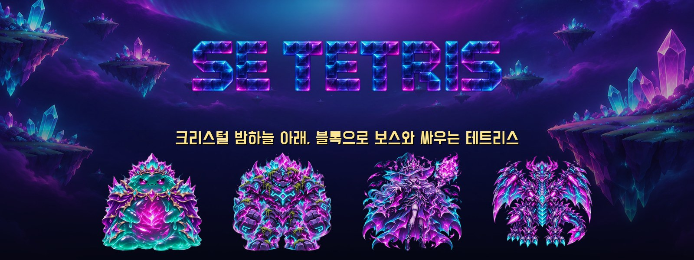

**혼자 쌓고, 둘이 겨루고, 함께 보스를 쓰러뜨리는 테트리스**<br>
Java 21 · Swing · 일반 / 아이템 / 대전 / 온라인 / 보스 레이드

[](https://github.com/yoobinkim541/STetris/releases/latest)
[](https://github.com/yoobinkim541/STetris/releases/tag/v0.5.0)


### [▶ 게임 받기 (JAR)](https://github.com/yoobinkim541/STetris/releases/download/v0.6.0-challenge.6/SE-Tetris.jar) · [Windows 실행 파일 (ZIP)](https://github.com/yoobinkim541/STetris/releases/download/v0.6.0-challenge.6/SE-Tetris-windows.zip)

<sub>JAR은 Java 21 이상에서 더블클릭, ZIP은 Java 없이 압축을 풀고 <code>SE Tetris.exe</code> 실행 · 기말 평가는 <a href="#평가-빌드-v050">평가 빌드 v0.5.0</a></sub>

</div>

<p align="center">
  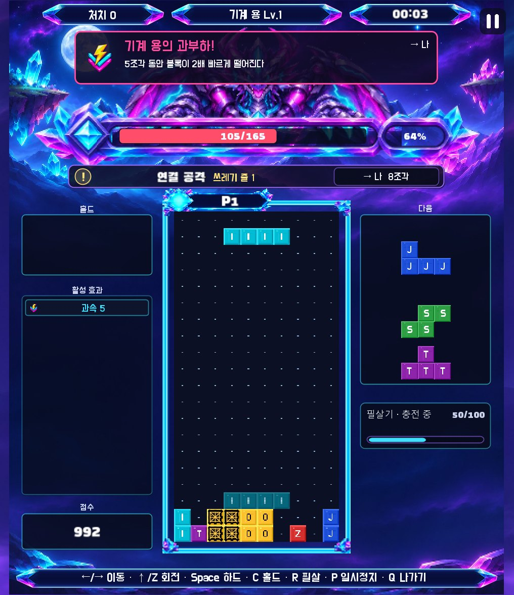
  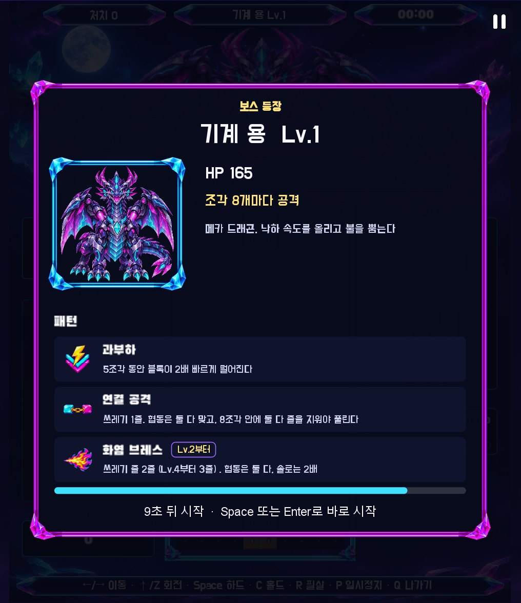
  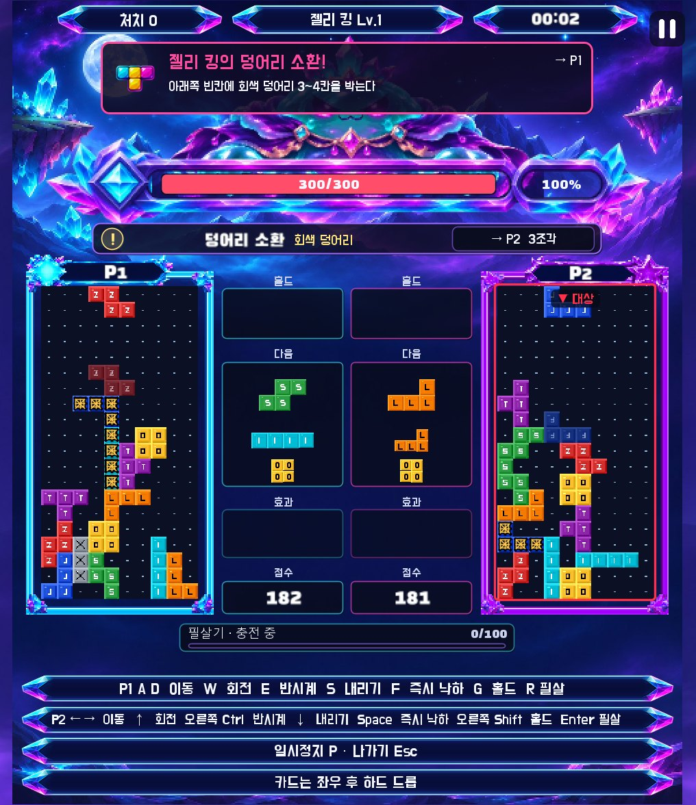
</p>

---

## 🌌 세계관

> 밤이 끝나지 않는 하늘에 수정 섬들이 떠 있다.<br>
> 이 세계를 떠받치는 것은 별빛이 굳어 생긴 일곱 가지 블록. 블록이 한 줄로 맞물려 사라질 때 터지는 빛은 무엇이든 꿰뚫는다.
>
> 그 빛을 노리고 네 괴물이 깨어났다.<br>
> 시야를 덮는 **젤리 킹**, 땅을 밀어 올리는 **석상 골렘**, 블록을 뒤트는 **밤의 마녀**, 하늘을 불태우는 **기계 용**.
>
> 블록을 쌓고, 줄을 지우고, 그 빛으로 싸워라. 혼자서도, 친구와 함께라도.<br>
> 네 괴물을 모두 쓰러뜨린 자만이 이 하늘의 끝에 이름을 새긴다.<br>
> <sub>…가끔은 어디선가 금빛으로 반짝이는 작은 블록 정령이 나타났다가 도망친다는 소문도 있다.</sub>

## 🎮 게임 모드

<table>
<tr>
<td width="33%" align="center">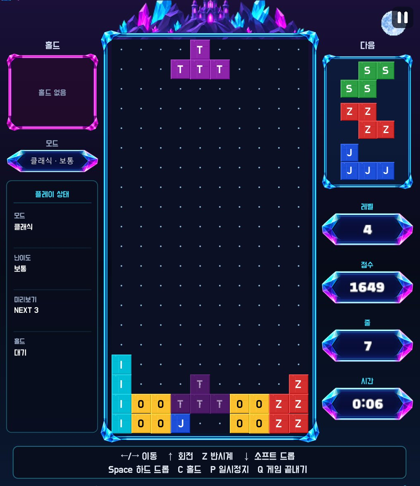<br><b>일반 게임</b><br><sub>Easy · Normal · Hard. 레벨이 오를수록 빨라진다</sub></td>
<td width="33%" align="center">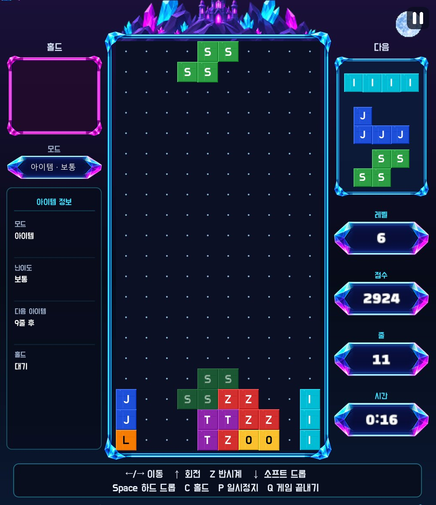<br><b>아이템 모드</b><br><sub>10줄마다 아이템. 줄 삭제·폭탄·점수 2배·슬로우·무게추</sub></td>
<td width="33%" align="center">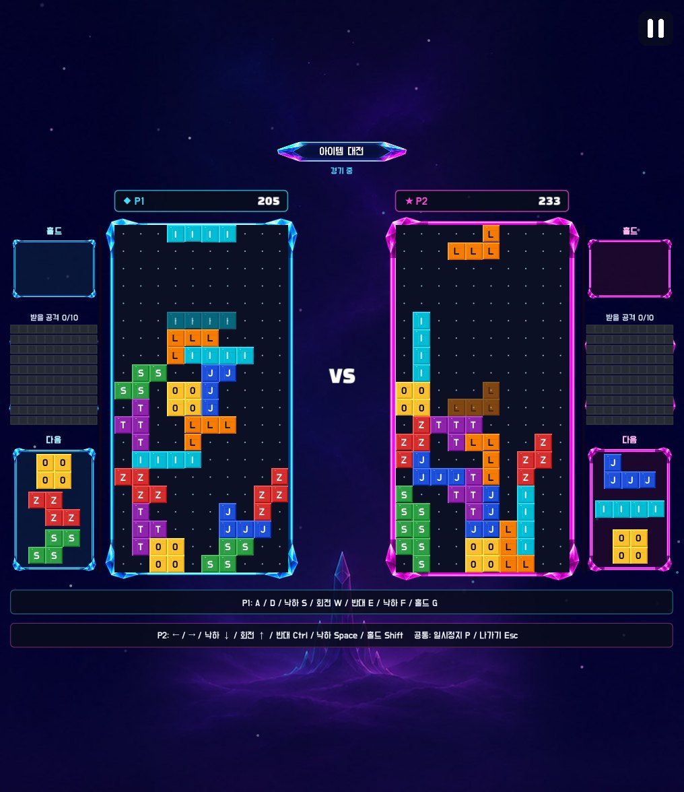<br><b>로컬 대전</b><br><sub>한 키보드 두 사람. 두 줄 이상 지우면 상대에게 공격</sub></td>
</tr>
<tr>
<td align="center">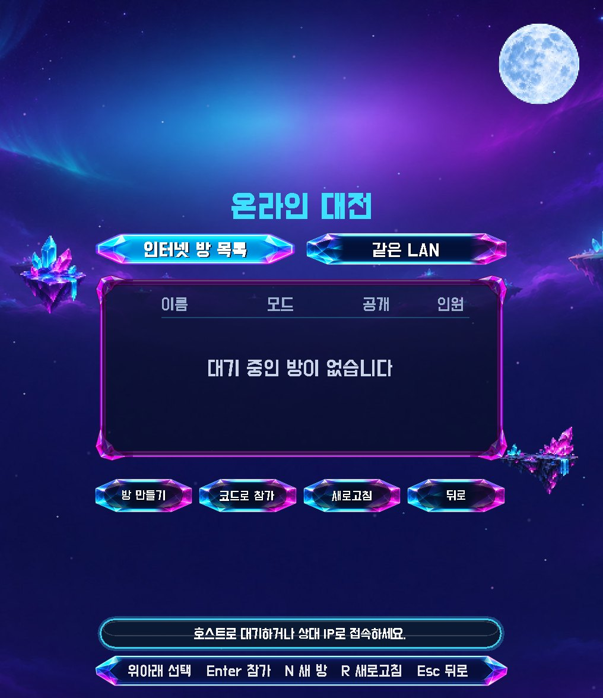<br><b>온라인 대전</b><br><sub>같은 LAN(IP 입력) 또는 인터넷(방 목록·방 코드)</sub></td>
<td align="center"><br><b>보스 레이드</b><br><sub>솔로 · 2인 협동 · 1v1 레이스</sub></td>
<td align="center">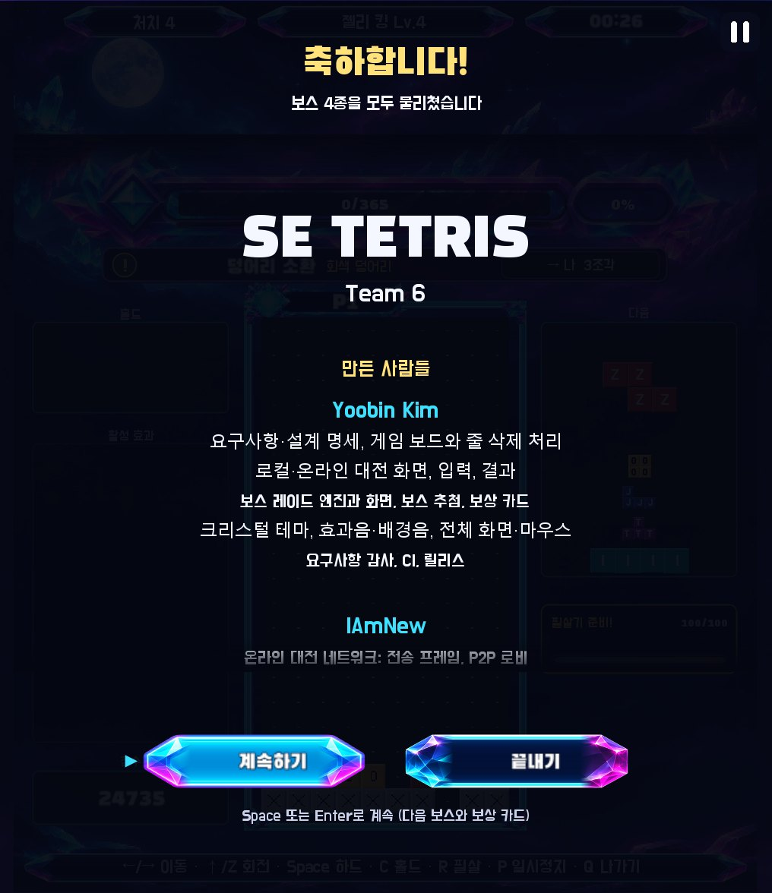<br><b>엔딩</b><br><sub>보스 4종을 모두 쓰러뜨리면 엔딩 크레딧</sub></td>
</tr>
</table>

| 모드 | 인원 | 이렇게 이긴다 |
|---|---|---|
| 일반 게임 | 1 | 오래 살아남아 높은 점수. 난이도별 Top 10 기록 |
| 아이템 모드 | 1 | 아이템을 잘 써서 높은 점수. 아이템 전용 Top 10 |
| 대전 (일반·아이템·시간제한) | 2 (한 PC 또는 온라인) | 상대 보드를 먼저 꼭대기까지 밀어 올린다. 시간제한은 180초 뒤 점수 비교 |
| 보스 레이드 솔로 | 1 | 줄을 지워 보스 HP를 깎는다. 끝없이 이어지며 처치 수로 겨룬다 |
| 보스 레이드 협동 | 2 (한 PC 또는 온라인) | 같은 보스를 둘이 함께. 쓰러진 동료는 줄을 지워 살린다 |
| 보스 레이드 레이스 | 2 (한 PC 또는 온라인) | 같은 보스를 각자 상대해 먼저 잡으면 상대에게 쓰레기 줄 2줄 |

## ⚔️ 보스 레이드

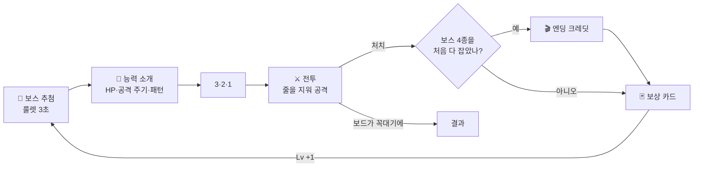

- **데미지**: 한 번에 지운 줄이 많을수록 강하다. 콤보, T-스핀, 금테 **럭키 블록**이 들어간 줄(크리티컬 ×2)이 데미지를 키운다
- **보스의 반격**: 정해진 조각 수마다 패턴을 쓴다. 다음 패턴과 남은 조각 수는 보스 아래 예고 띠에 미리 나온다
- **필살기**: 게이지가 100이 되면 R(협동 P2는 Enter). 협동은 두 사람이 1.5초 안에 함께 눌러야 터진다
- **단계**: 보스를 잡을 때마다 Lv +1, HP ×1.3, 공격 주기는 짧아진다. 보스는 4종을 한 바퀴 돌아야 다시 나온다
- **협동 규칙**: 보스 소개는 두 사람이 모두 넘겨야 끝나고, 보상 카드는 두 사람이 각자 한 장씩 고른다

### 👾 보스 도감

<table>
<tr>
<td align="center" width="25%">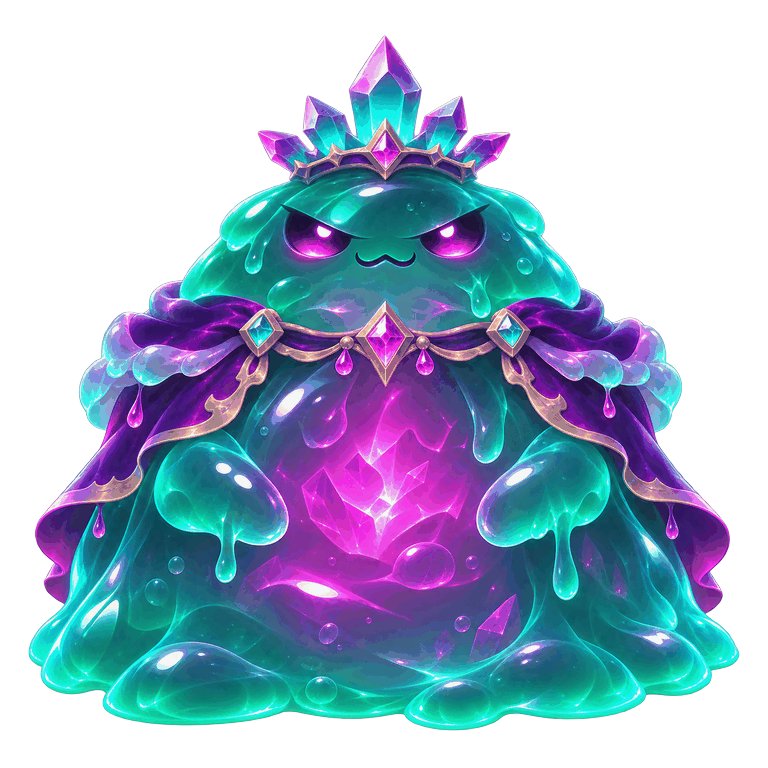<br><b>젤리 킹</b><br><sub>거대 슬라임. 시야를 가리고 덩어리를 떨군다</sub></td>
<td align="center" width="25%">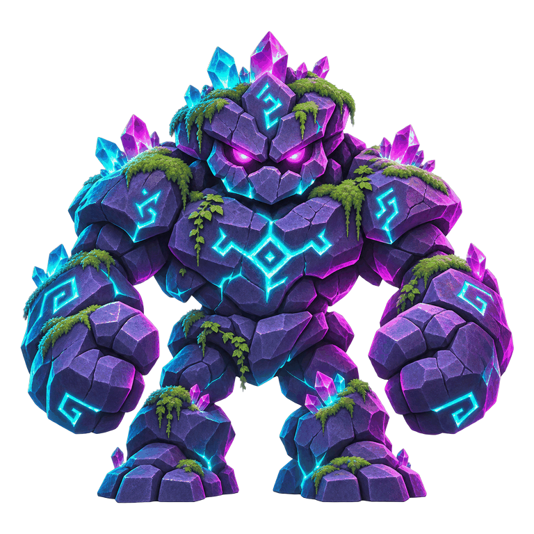<br><b>석상 골렘</b><br><sub>고대 돌 거인. 쓰레기 줄과 기둥으로 바닥을 밀어 올린다</sub></td>
<td align="center" width="25%"><br><b>밤의 마녀</b><br><sub>마법사. 다음 블록과 미리보기, 조작을 뒤튼다</sub></td>
<td align="center" width="25%">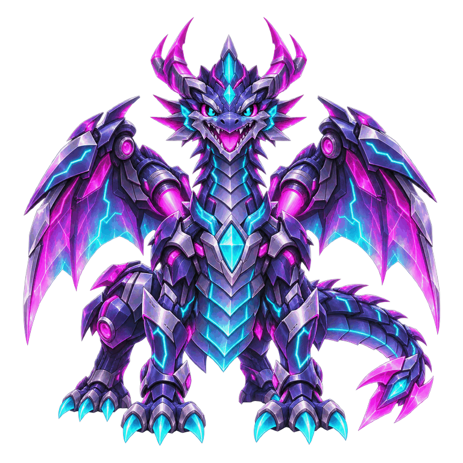<br><b>기계 용</b><br><sub>메카 드래곤. 낙하 속도를 올리고 불을 뿜는다</sub></td>
</tr>
<tr>
<td valign="top"><sub><b>점액 구름</b> 보드 4×3칸을 5조각 동안 가림<br><b>덩어리 소환</b> 빈칸에 회색 덩어리 3~4칸<br><b>분열</b> HP 절반에서 미니 젤리로 나뉨</sub></td>
<td valign="top"><sub><b>바위 투척</b> 쓰레기 줄 2줄 (Lv.4부터 3줄)<br><b>기둥 세우기</b> 한 열에 회색 기둥 4칸<br><b>지진</b> 구멍 1칸짜리 쓰레기 줄로 1줄 들어 올림</sub></td>
<td valign="top"><sub><b>저주 블록</b> 그 뒤 블록 2개를 S/Z로<br><b>미리보기 봉인</b> 4조각 동안 다음 1개만 보임<br><b>반전 주문</b> 3조각 동안 좌우 이동 반대</sub></td>
<td valign="top"><sub><b>과부하</b> 5조각 동안 2배 빠르게 낙하<br><b>연결 공격</b> 쓰레기 1줄, 협동은 둘 다 지워야 풀림<br><b>화염 브레스</b> 쓰레기 줄 2줄 (Lv.4부터 3줄)</sub></td>
</tr>
</table>

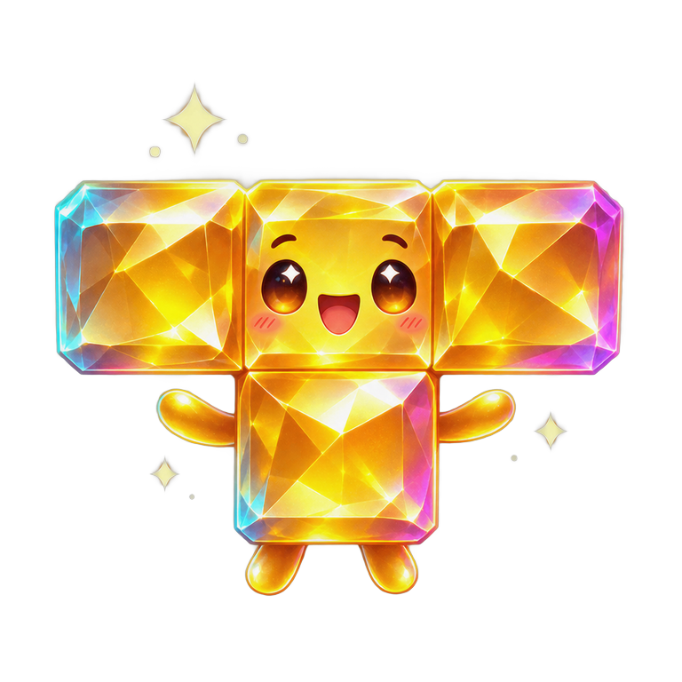

**숨은 보스 — 황금 테트로.** 가끔(5%) 다음 보스 대신 나타난다. 공격하지 않지만 15초 안에 잡지 못하면 도망간다. 잡으면 보상 카드를 두 번 고른다.

<br clear="right">

### 🃏 보상 카드

보스를 잡으면 카드 3장 중 하나를 고른다(솔로는 10초 안에, 협동은 두 사람이 각자).

<table>
<tr>
<td align="center">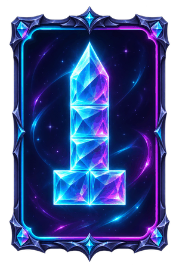<br><b>날카로운 블록</b><br><sub>이번 판 데미지 +10%</sub></td>
<td align="center">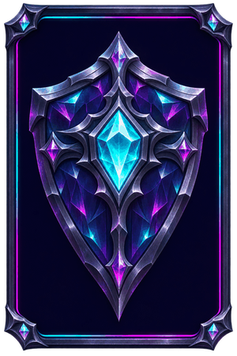<br><b>방패</b><br><sub>다음 패턴 1회 무효</sub></td>
<td align="center">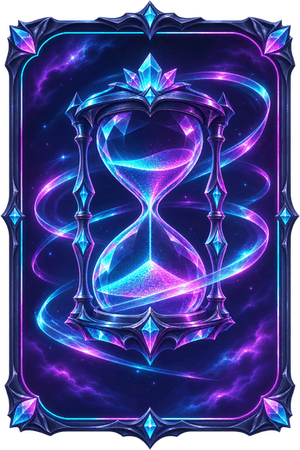<br><b>시간 왜곡</b><br><sub>다음 보스 첫 패턴 +4조각</sub></td>
<td align="center"><br><b>응원</b><br><sub>게이지 +50</sub></td>
<td align="center">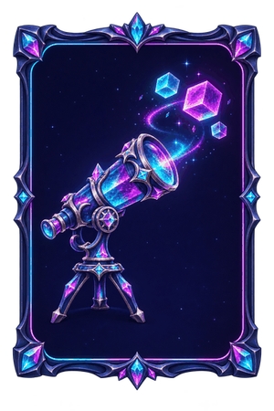<br><b>망원경</b><br><sub>NEXT 미리보기 +2</sub></td>
<td align="center"><br><b>행운</b><br><sub>럭키 블록 확률 2배</sub></td>
<td align="center">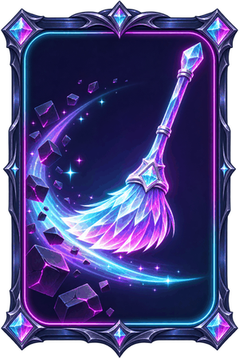<br><b>대청소</b><br><sub>내 보드 맨 아래 2줄 제거</sub></td>
</tr>
</table>

<p align="center">
  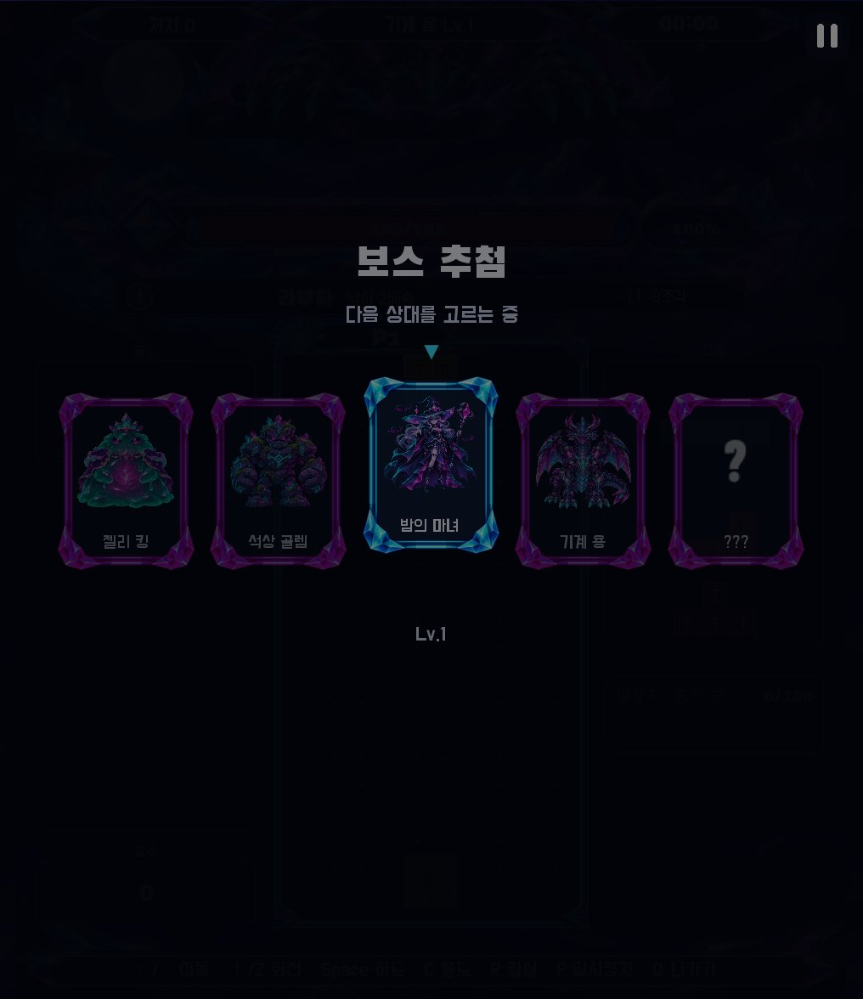
  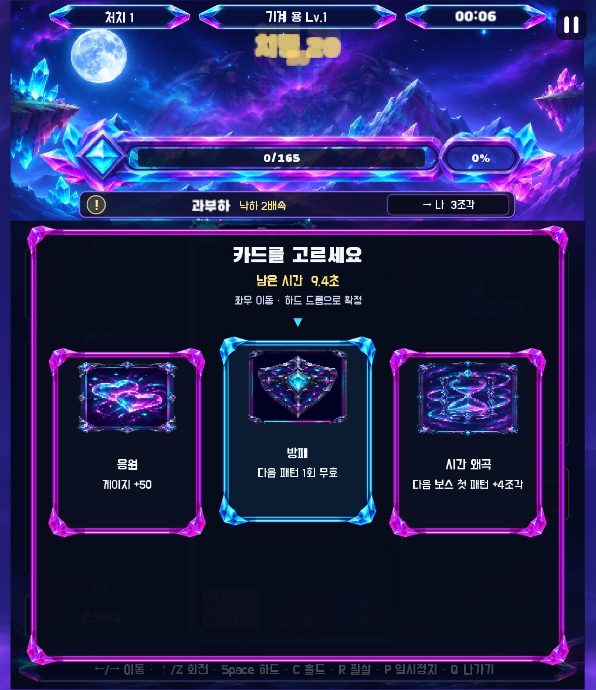
  
</p>

## 💎 아이템 (아이템 모드·아이템 대전)

| 문자 | 이름 | 효과 |
|:---:|---|---|
| **L** | 줄 삭제 | 아이템 칸이 있는 줄을 완성 여부와 관계없이 지운다 |
| **B** | 폭탄 | 아이템 칸 중심 3×3을 지운다 (칸당 10점) |
| **D** | 점수 2배 | 이후 10번 놓는 동안 줄 점수 2배 |
| **S** | 슬로우 | 이후 10블록 동안 낙하 간격 1.5배 |
| **W** | 무게추 | 회전할 수 없고, 아래 칸을 부수며 바닥까지 내려간다 |

## 🕹️ 조작

| 동작 | 혼자 할 때 | 한 PC 두 사람: 왼쪽 P1 | 오른쪽 P2 | 온라인 (각자 PC) |
|---|:---:|:---:|:---:|:---:|
| 좌우 이동 | ← → | A D | ← → | ← → |
| 회전 / 반시계 회전 | ↑ / Z | W / E | ↑ / `/` (슬래시) | ↑ / Z |
| 소프트 / 하드 드롭 | ↓ / Space | S / F | ↓ / Space | ↓ / Space |
| 홀드 | C | G | 오른쪽 Shift | C |
| 레이드 필살기 | R | R | Enter | R |
| 일시정지 · 나가기 | P · Q | P · Esc | P · Esc | P · Q (두 번 누르면 기권) |

- 혼자 할 때의 키는 **설정 → 조작 키**에서 바꿀 수 있고, 온라인도 이 키를 그대로 쓴다. 모던 조작(고스트·홀드·DAS·NEXT 3개)과 클래식 조작 중 고른다
- **F11** 또는 **Alt+Enter**로 전체 화면. 마우스로도 메뉴·버튼·카드·로비를 모두 누를 수 있다

## 🌐 온라인으로 함께

| 방법 | 이렇게 |
|---|---|
| **인터넷 방** | 온라인 대전 → 방 만들기(공개·비공개, 모드 선택) → 친구는 방 목록에서 고르거나 방 코드로 입장 |
| **같은 LAN** | 호스트가 IP를 알려 주고 상대가 입력. 최근 접속 주소 5개는 목록에서 고른다. 호스트는 TCP 47123 포트 허용 |

- 모드는 방장이 대기실에서 고르고(클릭 또는 ←/→), 두 사람이 모두 **게임 시작**을 누르면 시작한다
- 대전과 레이드(협동·레이스) 모두 온라인으로 할 수 있다. **두 사람이 같은 버전**을 써야 연결된다

## ✨ 그 밖의 기능

- **크리스털 밤하늘 테마**: 메뉴·게임·대전·레이드가 같은 보석 블록과 배경. 효과음·배경음(켬/끔)
- **화면**: 크기 3종, 전체 화면(모니터를 옮겨도 그 자리에서), 색맹 모드
- **기록**: 일반 난이도 3종·아이템의 Top 10 스코어보드. 설정과 기록은 `%APPDATA%/SETetrisTeam6/`에 저장
- **안전한 일시정지**: 창을 벗어나면 자동으로 멈추고, 대전은 누가 눌러도 함께 멈춘다

---

## 📦 받기와 실행

| 빌드 | 받기 | 내용 |
|---|---|---|
| **챌린지 빌드** (최신) | [JAR](https://github.com/yoobinkim541/STetris/releases/download/v0.6.0-challenge.6/SE-Tetris.jar) · [Windows ZIP](https://github.com/yoobinkim541/STetris/releases/download/v0.6.0-challenge.6/SE-Tetris-windows.zip) · [릴리스](https://github.com/yoobinkim541/STetris/releases/tag/v0.6.0-challenge.6) | 이 페이지의 모든 기능 |
| **평가 빌드** v0.5.0 | [JAR](https://github.com/yoobinkim541/STetris/releases/download/v0.5.0/SE-Tetris.jar) · [Windows ZIP](https://github.com/yoobinkim541/STetris/releases/download/v0.5.0/SE-Tetris-windows.zip) · [릴리스](https://github.com/yoobinkim541/STetris/releases/tag/v0.5.0) | 요구사항 3 기말 평가 제출본 (보스 레이드·인터넷 방 없음) |

```powershell
java -jar SE-Tetris.jar        # JAR (Java 21 이상)
.\gradlew.bat run              # 소스에서 바로 실행
```

ZIP은 압축을 모두 풀고 `SE Tetris/SE Tetris.exe`를 실행한다. Java 런타임이 들어 있어 따로 설치할 필요가 없다.

## 평가 빌드 v0.5.0

기말평가일은 **2026-12-01**이고, 평가는 [v0.5.0 릴리스](https://github.com/yoobinkim541/STetris/releases/tag/v0.5.0)로 한다. 같은 릴리스의 `SHA256SUMS.txt`로 파일을 대조할 수 있다. 평가 빌드의 커밋·테스트 결과·체크섬은 릴리스 노트와 [#162](https://github.com/yoobinkim541/STetris/issues/162)에 기록한다([릴리스 확인표](docs/release-checklist.md)). 챌린지 빌드와 평가 빌드는 서로 온라인으로 연결되지 않는다.

<details>
<summary><b>평가 기준 대전 규칙 (요구사항 3)</b></summary>

| 모드 | 규칙 |
|---|---|
| 일반 대전 | 설정의 난이도로 두 보드를 동시에 진행 |
| 아이템 대전 | 2차 아이템 규칙(NORMAL)으로 진행, 점수 2배·슬로우는 얻은 사람에게만 적용 |
| 시간제한 대전 | 180초, 일반 블록, NORMAL. 시간이 끝나면 점수 비교, 동점은 무승부 |

- **공격**: 한 번에 두 줄 이상 지우면, 지운 줄에서 방금 놓은 블록 칸만 비운 회색 줄이 상대 대기열로 간다. 상쇄는 없고, 대기열은 최대 10줄이다.
- **삽입·패배**: 공격 줄은 상대의 줄 삭제·점수 정산이 끝나고 다음 블록이 나오기 전에 아래에 들어간다. 고정 칸이 보이는 보드 위로 밀리거나 새 블록을 놓을 수 없으면 패배하고, 양쪽이 같은 판정 프레임에 지면 무승부다.
- **일시정지**: 누가 눌러도 두 보드가 함께 멈추고 함께 풀린다. 정지 동안 시간제한 시계도 멈춘다.
- **P2P 연결 상태**: heartbeat(0.5초)로 판단한다. 왕복 200ms 초과가 3번 이어지거나 1.5초 동안 받지 못하면 지연 안내, 5초 동안 받지 못하거나 상대가 끊으면 경기를 끝낸다. 평가장에서는 방화벽 전체를 끄지 말고 `scripts/firewall-rule.ps1`로 47123 포트 하나만 연다([평가장 네트워크 안내](docs/req3/evaluation-network-guide.md)).

규칙 질문 답변표: [대전 규칙 설명](docs/req3/s12-a-rules-brief.md) · 결정 근거: [결정 기록](docs/req3/decisions.md)

</details>

<details>
<summary><b>요구사항 충족 현황과 검증 기록</b></summary>

**기준: 2026-11-18 확인한 코드·병합 PR·이슈 기록.** '구현·자동 검증'은 프로젝트 명세 기준이며 교수자 승인이나 실제 사용자 평가 완료를 뜻하지 않는다.

| 영역 / 규칙 | 상태 | 근거 |
|---|---|---|
| 기본 게임·조작·Lock/Spawn·점수 | 구현·자동 검증 | `src/test`, [입력·수명주기 PR #98](https://github.com/yoobinkim541/STetris/pull/98) |
| 난이도·가중치 생성 (DIF/GEN) | 구현·자동 검증 | [PR #83](https://github.com/yoobinkim541/STetris/pull/83), [#91](https://github.com/yoobinkim541/STetris/pull/91), [#101](https://github.com/yoobinkim541/STetris/pull/101) |
| 아이템 예약·5종 효과 (ITM/ITL/ITB/ITD/ITS/ITW) | 구현·자동 검증 | [PR #88](https://github.com/yoobinkim541/STetris/pull/88), [#95](https://github.com/yoobinkim541/STetris/pull/95), [효과 계약](docs/item-modifier-contract.md) |
| 메뉴·삭제 연출·표시 (MOD/ANI/RND) | 구현·자동 검증 | [PR #100](https://github.com/yoobinkim541/STetris/pull/100), [#106](https://github.com/yoobinkim541/STetris/pull/106), [#107](https://github.com/yoobinkim541/STetris/pull/107) |
| 설정·4분류 Top 10·JSON 호환 (SET/SBD/PER) | 구현·자동 검증 | [PR #100](https://github.com/yoobinkim541/STetris/pull/100), [#103](https://github.com/yoobinkim541/STetris/pull/103), [#104](https://github.com/yoobinkim541/STetris/pull/104) |
| 비기능 테스트·LINE 70% 게이트 (§14.2/14.3, CI) | 구현·CI 성공 확인 | [PR #96](https://github.com/yoobinkim541/STetris/pull/96): 총 240,000회 입력, 시간·불변식 검증 |
| 아이콘·JRE 포함 EXE·ZIP·JAR (DEP/CD) | 구현·릴리스 공개 | [v0.5.0](https://github.com/yoobinkim541/STetris/releases/tag/v0.5.0), [EXE 검증 기록](docs/validation-report-2026-10-26.md) |
| 로컬 2인 대전·공격·대기열·승패 (3차) | 구현·자동 검증 | [Sprint 8 로컬 대전](docs/sprint8-local.md), [경계 검증 PR #175](https://github.com/yoobinkim541/STetris/pull/175), [스트레스 PR #177](https://github.com/yoobinkim541/STetris/pull/177) |
| 3모드·P2P 로비·호스트 권위 경기 (3차) | 구현·자동 검증 | [PR #150](https://github.com/yoobinkim541/STetris/pull/150), [#167](https://github.com/yoobinkim541/STetris/pull/167) |
| 다시 대전·지연·끊김·최근 IP (3차) | 구현·자동 검증 | [PR #158](https://github.com/yoobinkim541/STetris/pull/158), [#167](https://github.com/yoobinkim541/STetris/pull/167), [#174](https://github.com/yoobinkim541/STetris/pull/174), [#186](https://github.com/yoobinkim541/STetris/pull/186) |
| 같은 LAN 입력→두 화면 200ms (3차) | 두 PC 미검증 | 단일 PC 2프로세스 600입력 최대 66.30ms([PR #183](https://github.com/yoobinkim541/STetris/pull/183)). 두 PC Wi-Fi heartbeat RTT p95 256.9ms로 판정 근거 부족, 유선 재측정 필요([#159](https://github.com/yoobinkim541/STetris/issues/159)) |
| 평가장 접속·복구 연습, 타인 플레이, 대표 선수 (3차) | 미진행 | [#161](https://github.com/yoobinkim541/STetris/issues/161), [#172](https://github.com/yoobinkim541/STetris/issues/172), [#181](https://github.com/yoobinkim541/STetris/issues/181) |
| 실제 사용자 2명 평가 (2차) | 미진행 기록 | [평가 기록지](docs/user-playtest.md) |
| 실제 Windows IME·OS 배율·Alt+Tab 플레이 | 수동 확인 필요 | Java UI 배율·포커스 콜백 자동 검증과 별도 |
| 시간제한 규칙·아이템 대전 공격 해석·보드 크기·제출 형식 | 교수자 확인 필요 | [결정 기록 C장](docs/req3/decisions.md), [문의·답변 기록](docs/professor-confirmation.md) |

| 검증 | 기준 | 결과 |
|---|---|---|
| test + JaCoCo | develop `2cacf1c` (2026-11-18 로컬) | 1,274개 / 실패 0 / 생략 21, LINE 88.28% (5,326 / 6,033) |
| Package 워크플로 (v0.5.0-rc.2) | main `c929d01` (#191) | check·guiAcceptance·packageApp·EXE 실행 성공, 1,242개 / 실패 0 / 생략 21, LINE 88.16% |
| 평가 번들 (`scripts/build-eval-bundle.ps1`) | v0.5.0 평가 빌드 | 결과는 [#162](https://github.com/yoobinkim541/STetris/issues/162)와 릴리스 노트 |

2차 시점의 전체 인수 기록(requirementsAudit 71건, Java UI 배율 100/150/200%)은 [2026-10-26 보고서](docs/validation-report-2026-10-26.md)에 있다.

</details>

<details>
<summary><b>개발자 모드</b></summary>

실행 인자 `--dev`(또는 JVM 속성 `-Dtetris.dev=true`)로 켠다. 켜지 않으면 화면과 동작은 일반 실행과 같다.

- 창 제목에 `[개발자 모드]`가 붙는다.
- P2P 로비 아래에 RTT 측정 패널이 붙는다. `RTT 200회 측정`으로 PING을 200번 보내고, `CSV 저장`으로 `%APPDATA%/SETetrisTeam6/dev/rtt-<시각>.csv`에 저장한다.
- 설정의 `개발자: 연결 상태 표시`를 켜면 로비와 온라인 대전 화면에 RTT·수신 빈도 등 연결 상태 줄을 0.5초마다 보인다.

이 RTT는 앱이 주고받는 PING/PONG 기준이라 화면 처리 대기가 포함된다. 소켓 수준 왕복은 `NetTool`([200ms 측정 절차](docs/req3/s11-lan-measurement.md))로 잰다.

</details>

## 🛠️ 개발

<details>
<summary><b>구조</b></summary>

게임 규칙은 Swing에 직접 의존하지 않는 `GameSession`이 관리한다. UI는 명령을 전달하고 세션은 `GameListener`와 복사된 `GameSnapshot`으로 상태를 전달한다. 대전과 레이드는 호스트 PC의 엔진 하나(`LocalMatchEngine`, `RaidEngine`)가 결과를 정하고, 상대 PC는 입력을 보내고 상태를 받아 그린다.

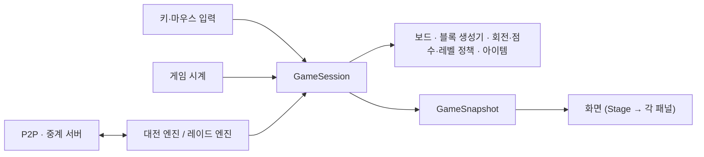

| 경로 (`src/main/java/tetris/` 기준) | 책임 |
|---|---|
| `component/block` | 7종 블록·무게추, 모양·회전·아이템 칸 |
| `feature/game` | 세션 상태, 모드·난이도, Lock/Spawn, 스냅샷·시계 계약 |
| `feature/data`, `feature/crash` | 보드 저장·삭제·압축, 배치·충돌 판정 |
| `feature/rule` | 가중치 7-bag 생성, Next 큐, Spawn·SRS 회전·Lock·점수·레벨 정책 |
| `feature/item` | L/B/D/S 효과, 삭제 대상 수집과 지속 효과 수명주기 |
| `feature/setting`, `feature/score`, `feature/save` | 설정·키 맵, 기록 분류, Jackson 기반 JSON 저장 |
| `feature/versus` | 대전 엔진: 두 세션의 판정 프레임, 공격 줄·대기열, 승패·시간제한 |
| `feature/raid` | 레이드 엔진: 보스·패턴·데미지·카드·소개·엔딩 크레딧 |
| `feature/network`, `relay/` | TCP 연결·프레임 형식·로비·heartbeat, 인터넷 방 중계 서버 |
| `ui` | 메뉴·게임·대전·레이드·설정·결과 화면, 렌더링·입력 |

상세: [3차 아키텍처](docs/req3/architecture.md) · [네트워크 프로토콜](docs/req3/network-protocol.md) · [챌린지 계획서](docs/challenge-plan-v2.md)

</details>

<details>
<summary><b>빌드·테스트·배포</b></summary>

JDK 21 이상이 필요하다. Windows EXE 패키징과 실제 창 인수 검증은 Windows에서 실행한다.

| 목적 | Windows 명령 | 결과 |
|---|---|---|
| 개발 실행 | `.\gradlew.bat run` | 게임 창 |
| 테스트·커버리지 | `.\gradlew.bat check` | 테스트와 LINE ≥ 70% 게이트 |
| 실제 창 검증 | `.\gradlew.bat guiAcceptance` | JFrame 기반 검증 |
| 실행 JAR | `.\gradlew.bat releaseJar` | `build/libs/SE-Tetris.jar` |
| Windows 패키지 | `.\gradlew.bat packageApp` | `build/distributions/SE-Tetris-windows.zip` |
| EXE 실행 검증 | `.\scripts\verify-package.ps1` | `build/verification/package-smoke.json` |

CI는 Linux 테스트·커버리지와 Windows 인수·패키징·EXE 실행을 검증한다. [Package 워크플로](.github/workflows/package.yml)는 `v*` 태그 빌드에서 ZIP/JAR을 Release에 올린다.

사용자 데이터 (`%APPDATA%/SETetrisTeam6/`): `settings.json`(화면·색맹·조작키·난이도), `scoreboard.json`(모드·난이도별 기록), `recent-peers.json`(최근 접속 주소 5개), `dev/rtt-<시각>.csv`(개발자 모드 RTT 표본)

</details>

<details>
<summary><b>문서 바로가기</b></summary>

- 3차 대전: [요구사항·인수 기준](docs/req3/requirements.md) · [결정 기록](docs/req3/decisions.md) · [아키텍처](docs/req3/architecture.md) · [네트워크 프로토콜](docs/req3/network-protocol.md) · [대전 규칙 설명](docs/req3/s12-a-rules-brief.md) · [시연 동선](docs/req3/s12-b-demo.md) · [리허설 진행표](docs/req3/s12-rehearsal-runsheet.md)
- 평가장 준비: [평가장 네트워크 안내·방화벽 스크립트](docs/req3/evaluation-network-guide.md) · [200ms 측정 절차](docs/req3/s11-lan-measurement.md)
- 2차: [요구사항 v2](docs/requirements-spec-v2.md) · [아이템 모드 명세서](docs/item-specification.md) · [체크리스트 80항목 대조](docs/checklist-compliance-2026-10-27.md)
- 챌린지: [챌린지 계획서](docs/challenge-plan-v2.md) · [에셋 출처](CREDITS.md)
- 기록: [감사 기록](docs/requirements-audit-2026-10-26.md) · [검증 보고서](docs/validation-report-2026-10-26.md) · [사용자 평가](docs/user-playtest.md) · [교수자 문의](docs/professor-confirmation.md) · [Notion 프로젝트](https://app.notion.com/p/Software-Enginering-Term-Project-Tetris-3e1a13e7df00802e96f8fe312fa590ea)

</details>

## 👥 만든 사람들

**Team 6** — 김유빈 · 심재윤 · 심규민

feature/fix 브랜치에서 develop으로 PR을 만들고 리뷰 후 병합한다. main은 배포용이다. 보스·카드·배경 그림은 gpt-image-2(Codex CLI)로 만들었고, 효과음·배경음은 팀 스크립트로 합성했다. 글꼴은 Black Han Sans · Do Hyeon · Orbitron(SIL OFL 1.1). 자세한 출처는 [CREDITS.md](CREDITS.md).
